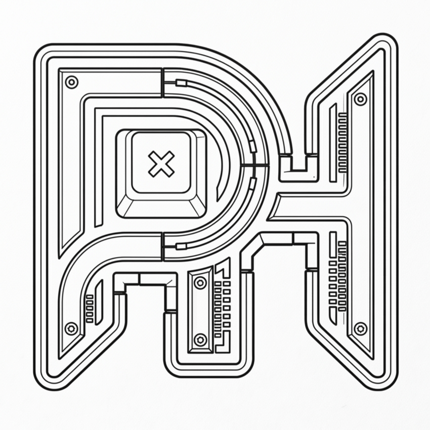
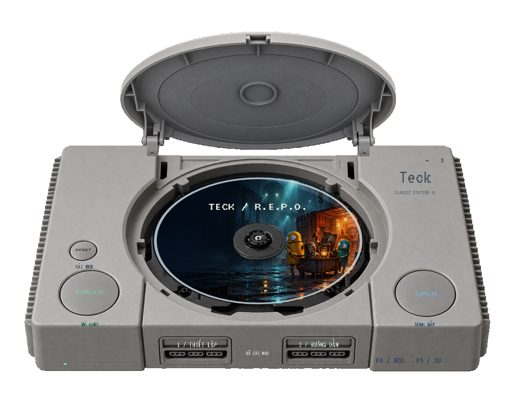
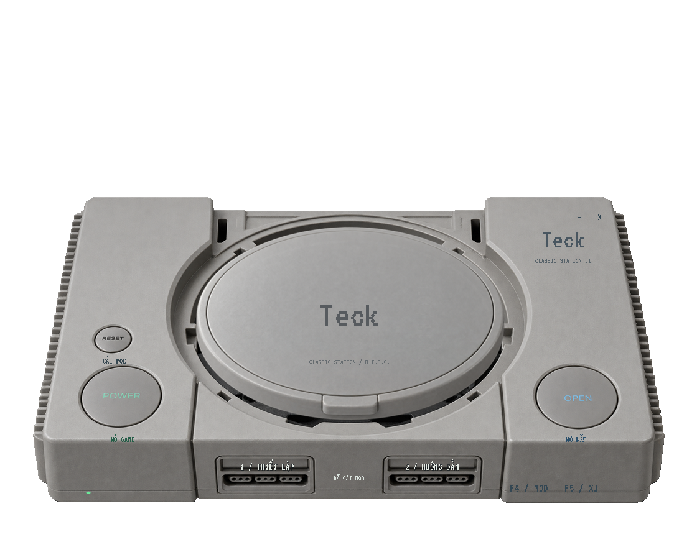

<div align="center">
  
  <h1>TECK</h1>
  <p><strong>R.E.P.O. Mod Launcher</strong></p>
  <p>Thiết kế hoài cổ. Cài đặt tập trung. Tùy chỉnh cách chơi.</p>
  
  <p>
    <a href="#bắt-đầu">Bắt đầu</a> ·
    <a href="#giao-diện">Giao diện</a> ·
    <a href="docs/USER_GUIDE.md">Hướng dẫn</a> ·
    <a href="CHANGELOG.md">Lịch sử cập nhật</a>
  </p>
</div>

---
## 📥 Tải xuống

Bạn có thể tải phiên bản mới nhất của launcher tại đây:

* **[Teck-PS1-VI-EN.exe](ĐƯỜNG_DẪN_TẢI_XUỐNG_CỦA_BẠN)**

> ⚠️ **Lưu ý về Windows Defender:** 
> Việc phân phối trực tiếp file `.exe` hiện đang bị Microsoft Defender nhận diện nhầm (hiện tượng phổ biến với các ứng dụng đóng gói bằng PyInstaller hoặc chưa có chữ ký số). Nếu phần mềm diệt virus chặn lại, bạn có thể an toàn cho phép nó chạy hoặc xem mã nguồn để tự build.


**Teck** là launcher dành cho R.E.P.O. trên Windows, kết hợp bộ cài mod với giao diện lấy cảm hứng từ PlayStation đời đầu. Nắp máy mở để lộ đĩa xoay; các nút trên thân máy trở thành nút mở game, cài mod và thiết lập.

## Giao diện



<details>
<summary><strong>Xem khi đóng nắp</strong></summary>



</details>

*Ảnh được xuất từ giao diện launcher. Vùng ngoài thân máy trong suốt khi chạy trên desktop.*

## Có gì trong Teck?

| | Trải nghiệm |
| --- | --- |
| **Giao diện cổ điển** | Vỏ máy PS1, nắp chuyển động mượt, đĩa xoay, font pixel và logo Teck. |
| **Cài đặt tập trung** | Cài, cập nhật và gỡ bộ mod do launcher quản lý từ một ứng dụng EXE. |
| **Chơi cùng nhóm** | Thiết lập 2–20 người qua MorePlayers và tùy chỉnh chia sẻ nâng cấp. |
| **Công cụ trong game** | Mở GameTools bằng F4; trang trí và xu trang trí bằng F5. |
| **Việt / Anh** | Chuyển ngôn ngữ trong GameTools và CosmeticsTools bằng nút VI / EN; lưu lựa chọn. |

Giới hạn người chơi và khả năng hoạt động của từng mod phụ thuộc phiên bản game cùng bộ mod trong phòng.

## Bắt đầu

**Hiện chỉ đăng mã nguồn và tài liệu để xem xét.** Không đính kèm EXE bị Defender cảnh báo. Các bước dưới đây mô tả cách sử dụng đã thiết kế, không phải khuyến nghị chạy bản đang bị phát hiện.

1. Đóng R.E.P.O., sau đó mở Teck.
2. Bấm **1 / THIẾT LẬP** và chọn thư mục chứa `REPO.exe` cùng `REPO_Data`.
3. Chỉnh số người chơi và tùy chọn chia sẻ nâng cấp.
4. Bấm **RESET / CÀI MOD**, chờ hoàn tất rồi bấm **POWER / MỞ GAME**.

**Cập nhật từ bản cũ:** đóng game → chạy EXE mới → RESET / CÀI MOD → mở lại game.

Xem [hướng dẫn đầy đủ](docs/USER_GUIDE.md) để biết chức năng từng nút, đổi ngôn ngữ và cách gỡ mod.

## Bộ mod

| Thành phần | Phiên bản | Vai trò |
| --- | --- | --- |
| BepInExPack | 5.4.2305 | Nạp plugin |
| MorePlayers | 1.1.0 | Giới hạn người chơi |
| SharedUpgradesPlus | 1.6.1 | Chia sẻ nâng cấp |
| MenuLib | 2.5.2 | Thư viện menu |
| REPOConfig | 1.2.6 | Thiết lập mod |
| GameTools | 1.0.9 | Công cụ tùy chỉnh trong game |
| CosmeticsTools | 1.0.1 | Trang trí và xu trang trí |
| Teck Vietnamese | DLL 1.2.0 | Bản dịch, chuyển VI / EN |

Tác giả, nguồn gốc và font được ghi trong [THIRD_PARTY.md](THIRD_PARTY.md). Logo do chủ dự án cung cấp.

## Yêu cầu và kiểm chứng

Windows có **.NET Framework 4.x**, R.E.P.O. cài qua Steam và phiên bản game tương thích với bộ mod đi kèm.

Đã kiểm tra quy trình cài/cập nhật/gỡ trong thư mục thử nghiệm, bản dịch, mã xử lý chuyển ngôn ngữ và độ rộng các nhãn được rút gọn. Chưa kiểm chứng trực tiếp toàn bộ tính năng và bố cục menu trong game.

## Mã nguồn và đóng góp

Để build launcher, mở PowerShell tại thư mục dự án:

**Lưu ý:** tự build không xác nhận phần mềm an toàn. Lệnh này có chạy EXE để self-test và xuất ảnh xem trước; không chạy trong lúc chưa xác minh cảnh báo. Có thể đọc mã và script trực tiếp để xem xét.

```powershell
powershell -NoProfile -ExecutionPolicy Bypass -File .\build.ps1
```

Kết quả nằm trong `dist/`. Script nhúng các gói mod đã Việt hóa, chạy self-test và tạo ảnh xem trước. Mã dịch trong `src/localization/` được cung cấp riêng để tham khảo; script này không biên dịch lại plugin dịch.

Cách báo lỗi và đề xuất cải tiến: [CONTRIBUTING.md](CONTRIBUTING.md).

---

<div align="center">
  <strong>TECK · Một chút hoài cổ cho mỗi lần bắt đầu.</strong>
  <p>Dự án cộng đồng, không liên kết với Sony, PlayStation hoặc nhà phát triển R.E.P.O.</p>
</div>
